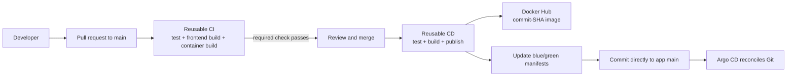

# K8s App Deployment: CI/CD Pipeline Setup

This guide configures the reusable GitHub Actions workflows in this repository
for the [`k8s-app-deployment`](https://github.com/OWNER/k8s-app-deployment)
React application. Replace `OWNER` with the account or organization that owns
both repositories.

## Pipeline flow



- **CI on a pull request:** runs `npm ci`, `npm test`, `npm run build`, the
  blue/green promotion unit tests, and a container build. It does not log in to
  Docker Hub, publish an image, or write to the application repository.
- **CD after merge:** repeats validation, publishes
  `docker.io/<dockerhub-username>/k8s-app-deployment:<full-git-sha>`, updates
  the blue/green Kubernetes manifests, and pushes that manifest change to the
  application repository's `main`.
- **Argo CD:** watches the app repository's Git revision. The manifest image
  tag is the hand-off from CI/CD to the cluster; Argo CD is not polling Docker
  Hub for new tags.

The image tag is the source commit SHA, not `latest`, so every Deployment
references a traceable, immutable release.

## Workflow files and GitHub requirements

GitHub only discovers executable workflow YAML files directly under
`.github/workflows/`. Do not move these into nested directories.

### In this reusable-workflows repository

| File | Purpose |
|---|---|
| `.github/workflows/k8s-app-deployment-ci.yml` | Reusable pull-request validation workflow |
| `.github/workflows/k8s-app-deployment-cd.yml` | Reusable build, Docker Hub publish, and GitOps promotion workflow |
| `.github/workflows/taskboard-java.yml` | Existing Java workflow; remains separate and unchanged |

The two React workflows run in the **application repository's context** when
called. `actions/checkout` therefore checks out the caller repository, not
`ci-cd-pipelines`.

### In the application repository

| File | Trigger and reusable workflow |
|---|---|
| `.github/workflows/ci.yml` | Pull requests targeting `main`; calls `k8s-app-deployment-ci.yml` |
| `.github/workflows/cd.yml` | App/code changes pushed to `main`; calls `k8s-app-deployment-cd.yml` |

Set the owner in each caller's `uses:` reference:

```yaml
uses: OWNER/ci-cd-pipelines/.github/workflows/k8s-app-deployment-ci.yml@main
```

The CD caller similarly references `k8s-app-deployment-cd.yml`. The sample
uses `@main` for learning convenience; pin reusable workflows to a reviewed
release tag or full commit SHA in production.

The current path filters intentionally exclude Kubernetes-only manifest
changes from rebuilding the frontend. The CD caller includes `scripts/**`
because changes to the blue/green promotion code must also exercise CD.

## Docker Hub setup

1. Create a Docker Hub repository named `k8s-app-deployment`. Make it public
   for this learning setup so K3s can pull images without registry credentials.
2. Create a Docker Hub access token with write permission. Use a token, not
   your Docker Hub password.
3. In the **application repository**, open **Settings → Secrets and variables
   → Actions → New repository secret** and add:

   | Secret | Value |
   |---|---|
   | `DOCKERHUB_USERNAME` | Your Docker Hub username |
   | `DOCKERHUB_TOKEN` | The Docker Hub access token |

The PR CI workflow does not receive these secrets. The CD workflow uses them
only to authenticate to Docker Hub. Docker Hub images are not stored in this
GitHub repository, and GitHub Actions does not need AWS credentials or a
Kubernetes administrator kubeconfig.

## Allow the CD manifest commit

The reusable CD workflow commits the updated image references directly to the
application repository's `main` branch. Its caller grants `contents: write`.
It uses GitHub's short-lived `GITHUB_TOKEN` for Git operations; this is
separate from the Docker Hub token.

In the application repository:

1. Open **Settings → Actions → General → Workflow permissions**.
2. Allow workflows read and write permissions.
3. Keep the caller job permission scoped to `contents: write`.
4. Check branch rules: a rule requiring a PR for every `main` update can reject
   the automation's direct push.

For a learning repo, allow the controlled bot push. For a production repo with
mandatory review on all changes, change the promotion step to open a
manifest-update PR; do not weaken the required review rule just to permit a
bot push.

The workflow serializes CD runs so two merged changes cannot concurrently
update the active/inactive color. The image push completes before manifest
promotion; if promotion fails, the image is published but Argo CD remains on
the old Git desired state and continues serving the old color.

## Configure CI as a required check

1. Push the caller workflow and reusable-workflow repository to GitHub.
2. Create a pull request that changes an app source/build file and verify the
   `React CI / validate` check passes.
3. Protect `main` with pull requests and require the CI check before merging.
4. Add Docker Hub secrets and the CD write permission before the first merge
   intended to deploy.
5. Merge a source change and follow the `React CD` run. Confirm the image is
   present in Docker Hub and the blue/green manifest commit appears on `main`.
6. Let Argo CD reconcile the manifest as documented in
   [K3s and Argo CD Blue/Green Guide](K3S-ARGOCD-BLUE-GREEN-GUIDE.md).

The first CD release initializes both color Deployments to the same image and
keeps blue active. Later CD releases update the inactive Deployment and change
the Service selector in Git; sync waves make Argo CD wait for that Deployment
to become Healthy before changing traffic.

## Troubleshooting

| Symptom | Check |
|---|---|
| Reusable workflow not found | Owner spelling, repository visibility/Actions policy, workflow filename, and `@main` ref |
| `npm ci` fails | `package-lock.json` matches `package.json`; Node.js is set to 22.12.0 |
| Docker Hub login/push fails | Repository secrets exist in the app repository; token has write permission; repository name is correct |
| CD publishes an image but cannot push manifests | Caller grants `contents: write`, Actions workflow permissions allow writes, and branch rules permit the bot push |
| CI/CD does not run | Check the trigger branch and path filters; docs-only or Kubernetes-only changes intentionally do not build the app |
| Argo CD does not deploy a published tag | Confirm the promotion commit changed manifests; Argo CD deploys Git state, not registry tag events |

## Security notes

- Keep Docker Hub credentials out of YAML, source files, and build arguments.
- Do not add AWS credentials or a cluster-admin kubeconfig to GitHub Actions.
- Keep reusable workflow references on an approved immutable ref in production.
- Make source/image repositories public only if their contents are safe to
  disclose; otherwise configure scoped Argo CD and Kubernetes pull credentials.
- Configure PR reviews and required status checks before merging to `main`.
