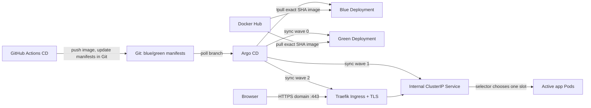

# K3s and Argo CD Blue/Green Deployment Guide

This guide explains the Kubernetes side of the
[`k8s-app-deployment`](https://github.com/OWNER/k8s-app-deployment) GitOps
deployment: K3s on one EC2 instance, Argo CD watching Git, and a blue/green
release controlled by a Service selector. It complements the app repository's
[complete hands-on AWS guide](https://github.com/OWNER/k8s-app-deployment/blob/main/doc/COMPLETE-HANDS-ON-GUIDE.md).

## Desired-state and traffic flow



Argo CD watches the configured **Git branch and path**. It does not
automatically watch Docker Hub for new images. The CD workflow publishes an
immutable commit-SHA image, writes that exact reference to the inactive
Deployment, and changes the Service slot selector in Git. Argo CD then applies
the Git change.

## What the repository deploys

The app repo's `k8s/base/kustomization.yaml` includes:

- `namespace.yaml`: `k8s-demo`, sync wave `-1`.
- `cluster-issuer.yaml`: Let's Encrypt ClusterIssuer, sync wave `-2`; requires
  cert-manager CRDs/controller to be installed before the Application.
- `deployment-blue.yaml` and `deployment-green.yaml`: one Pod each, sync wave
  `0`, and distinct `app.kubernetes.io/slot` labels.
- `service.yaml`: internal `ClusterIP` Service, sync wave `1`, initially
  selecting blue.
- `ingress.yaml`: host-based Traefik ingress, sync wave `2`, requests TLS for
  the configured domain using cert-manager.
- `middleware.yaml`: redirects application HTTP requests to HTTPS.

The host and issuer email in these manifests are intentional setup
placeholders. Replace them with the domain and contact email you control
before installing the Argo CD Application.

Both Deployments use the same container security settings: non-root user,
read-only root filesystem, dropped Linux capabilities, CPU/memory requests and
limits, and `/healthz` readiness/liveness probes. The image is public in the
learning configuration so K3s can pull from Docker Hub without a
`imagePullSecret`.

## Blue/green release behavior

### Initial release

The manifests begin with a `replace-me` image placeholder in both colors and
the Service selects blue. The first CD run:

1. Tests and builds the app, then pushes a Docker Hub image tagged by the
   source commit SHA.
2. `scripts/promote_image.py` recognizes the initial placeholder and writes
   that same image into both Deployment manifests.
3. It leaves the Service selecting blue.
4. The automation commits these Git changes to the application repository's
   `main`.
5. Argo CD creates the namespace, both Deployments, then the Service.

Run the first CD release successfully **before applying the Argo CD
Application**, so Argo CD does not initially try to pull the placeholder tag.

### Subsequent releases

With blue active, CD updates green's image and changes the Service selector to
green. On the next release, blue is the inactive slot and the process reverses.
The active Deployment keeps its previous image, so it is available as the
previous version after a successful switch.

The ordering relies on Argo CD sync waves:

1. ClusterIssuer at wave `-2` (cert-manager must already be installed and its
   CRDs established).
2. Namespace at wave `-1`.
3. Blue/green Deployments at wave `0`.
4. Service and HTTPS redirect middleware at wave `1`.
5. Ingress at wave `2`.

Argo CD processes a higher wave after the lower wave's resources are Healthy.
For the inactive Deployment, health depends on its rollout and the Pod passing
its readiness probe. That delays the Service-selector switch until the new
color is ready. If the new Deployment cannot become Healthy, the old selector
remains the applied Service routing configuration and the old color continues
to serve traffic.

Blue/green requires capacity for **both** app Pods at once. On a single EC2
host it does not provide host-level high availability: if the EC2 instance
fails, both colors are unavailable.

## Install K3s on EC2

The broader AWS steps (instance sizing, budget alerts, instance role, security
group, and Session Manager) are in the
[complete app deployment guide](https://github.com/OWNER/k8s-app-deployment/blob/main/doc/COMPLETE-HANDS-ON-GUIDE.md).
Follow that guide's sections 4.1-4.4 to create the budget alert, IAM role,
security group, EC2 host, K3s, and Argo CD. For the public app, the target setup
is a stable Elastic IP and a DNS A record; inbound TCP 80/443 is public web
traffic, while NodePort 30080, Argo CD 30443, SSH, and the Kubernetes API stay
closed. Administrative access uses Session Manager.

On the Amazon Linux 2023 EC2 instance:

```bash
curl -sfL https://get.k3s.io | sudo sh -
sudo systemctl status k3s --no-pager
sudo k3s kubectl get nodes -o wide
```

The install command executes the upstream installer. For production, review
the installer, pin a reviewed K3s version, and verify it before installation.
Keep `/etc/rancher/k3s/k3s.yaml` private; do not commit or upload the
administrator kubeconfig.

## Install Argo CD

Install Argo CD in its own namespace:

```bash
sudo k3s kubectl create namespace argocd
sudo k3s kubectl apply -n argocd \
  -f https://raw.githubusercontent.com/argoproj/argo-cd/stable/manifests/install.yaml
sudo k3s kubectl -n argocd rollout status deployment/argocd-server --timeout=5m
sudo k3s kubectl -n argocd get pods
```

For production, pin a reviewed Argo CD release instead of using the moving
`stable` manifest.

The Argo CD Application lives at
`k8s-app-deployment/argocd/application.yaml`. Set `OWNER` to the GitHub owner
and verify it points to:

```yaml
repoURL: https://github.com/OWNER/k8s-app-deployment.git
targetRevision: main
path: k8s/base
```

Before applying the Application:

1. Associate an Elastic IP with the EC2 instance and create a DNS A record for
   the app hostname pointing to that address. Wait until DNS resolves correctly.
2. Allow inbound TCP 80 and 443 in the instance security group; do not allow
   the app NodePort or Argo CD UI from the internet.
3. Install cert-manager from its official release manifest, pinning a release
   compatible with the cluster. Wait for `cert-manager`, `cert-manager-webhook`,
   and `cert-manager-cainjector` to become Available.
4. In the app repository, replace both `app.example.com` host entries in
   `k8s/base/ingress.yaml` with your DNS name and replace
   `REPLACE-WITH-YOUR-EMAIL` in `k8s/base/cluster-issuer.yaml`. Commit and push
   those manifest changes. They do not require rebuilding the app.
5. Run the first CD release so both Deployments have a real image SHA.

The [complete app hands-on guide](https://github.com/OWNER/k8s-app-deployment/blob/main/doc/COMPLETE-HANDS-ON-GUIDE.md)
has the detailed AWS console clicks, DNS record fields, cert-manager install
commands, and Session Manager UI tunnel.

Apply the committed Application manifest on the EC2 host:

```bash
sudo k3s kubectl apply \
  -f https://raw.githubusercontent.com/OWNER/k8s-app-deployment/main/argocd/application.yaml
sudo k3s kubectl -n argocd get applications
sudo k3s kubectl -n k8s-demo get deploy,pods,services
sudo k3s kubectl -n k8s-demo get ingress,certificate
```

The sample assumes the Git repo and Docker Hub image are public. For private
Git, configure an Argo CD repository credential as a Kubernetes Secret; for a
private Docker Hub repo, create a namespace-scoped `imagePullSecret` from a
read-only token. Never put credentials into the `Application` or workload
manifest.

## Stable public HTTPS endpoint

The application's Kubernetes Service is private (`ClusterIP`). K3s's bundled
Traefik Ingress controller receives traffic on the EC2 host's ports 80 and 443.
Open the configured hostname:

```text
https://app.example.com
```

Use your actual configured domain in place of `app.example.com`. cert-manager
performs the Let's Encrypt HTTP-01 challenge over public port 80, creates the
`deploylab-tls` Secret, and renews the certificate before expiry. HTTP requests
are redirected to HTTPS. If issuance fails, inspect the Certificate,
CertificateRequest, Order, and Challenge resources and verify DNS and inbound
ports 80/443 before retrying.

## Observe deployments and switch state

Useful commands from Session Manager:

```bash
sudo k3s kubectl -n argocd get application deploylab
sudo k3s kubectl -n k8s-demo get deployments,pods,services -o wide
sudo k3s kubectl -n k8s-demo get pods --show-labels
sudo k3s kubectl -n k8s-demo get ingress,certificate
sudo k3s kubectl -n cert-manager get certificaterequests,orders,challenges
sudo k3s kubectl -n k8s-demo describe service deploylab
sudo k3s kubectl -n k8s-demo describe deployment deploylab-blue
sudo k3s kubectl -n k8s-demo describe deployment deploylab-green
sudo k3s kubectl -n k8s-demo get events --sort-by=.lastTimestamp
```

The Service's `app.kubernetes.io/slot` selector is the active color:

```bash
sudo k3s kubectl -n k8s-demo get service deploylab \
  -o jsonpath='{.spec.selector.app\.kubernetes\.io/slot}'
echo
```

Do not use a manual `kubectl patch service` as a durable deployment change:
Argo CD self-healing will restore the selector recorded in Git. To roll back,
revert the manifest promotion commit in the app repository. Argo CD then
reconciles the Service and Deployment manifests to the previous Git state.

## Troubleshooting

| Symptom | Checks |
|---|---|
| Argo CD is `OutOfSync` | Application repo URL, `main`, `k8s/base` path, Git visibility/credentials, and latest promotion commit |
| `ImagePullBackOff` | Docker Hub image name/tag in the selected Deployment, package visibility, node outbound internet |
| Service has no endpoints | Compare Service slot selector with blue/green Pod labels; inspect readiness probes |
| New color never becomes Healthy | Inspect the Deployment rollout, Pod events/logs, node memory/disk pressure, and `/healthz` |
| Service switched before new app is ready | Confirm both Deployments have sync wave `0`, Service has wave `1`, and automatic sync is enabled |
| Domain does not resolve | DNS A record points to the Elastic IP; remove incorrect AAAA record; allow time for propagation |
| Certificate is not Ready | Confirm cert-manager components are available, DNS points to this EC2 host, and ports 80/443 are reachable; inspect cert-manager Challenge/Order events |
| Ingress returns 404 | Request host matches the Ingress host; Traefik is running; app Service has ready endpoints |
| Old version returns after a manual patch | Expected with Argo CD self-heal; change desired state in Git instead |

## Blue/green limitations

- The current strategy changes the Service selector after Argo CD considers
  the new Deployment Healthy. It is a simple hands-on switch, not a complete
  production progressive-delivery controller.
- Keeping both colors running uses more cluster resources than a one-slot
  rolling update.
- A single K3s node remains a single point of failure.
- Public traffic uses an Elastic IP, DNS, Traefik, and automated HTTPS, but
  the example does not include a managed load balancer, WAF, application
  authentication, traffic analysis, or automated post-switch rollback.

For additional AWS setup, billing/cost safeguards, GitHub secret configuration,
pipeline troubleshooting, and resource teardown, continue with
[`CI/CD Pipeline Setup`](CI-CD-PIPELINE-SETUP.md) and the
[complete app hands-on guide](https://github.com/OWNER/k8s-app-deployment/blob/main/doc/COMPLETE-HANDS-ON-GUIDE.md).
